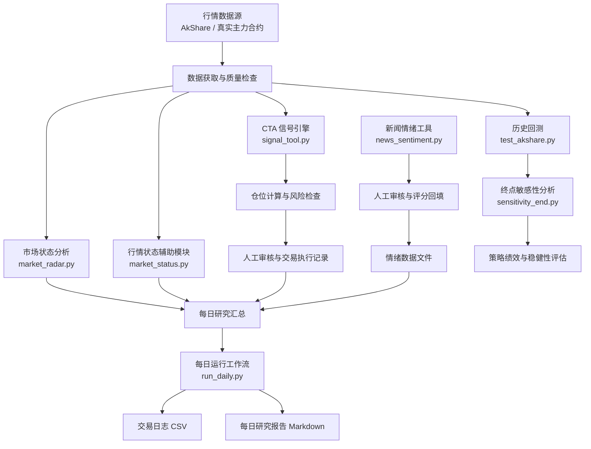

<p align="center">
  
  
  
  
</p>

<p align="center">
  <strong>商品期货量化研究与风险管理系统</strong>
  <br />
  基于改良海龟法则的 CTA 趋势跟踪策略与多模块投研工作流
  <br /><br />
  <code>Data Integrity</code> ·
  <code>Systematic Trading</code> ·
  <code>Risk Control</code> ·
  <code>Behavioral Audit</code>
</p>

---

## 目录

- [01 项目概述](#01-项目概述)
- [02 核心特性](#02-核心特性)
- [03 系统架构](#03-系统架构)
- [04 策略逻辑与参数](#04-策略逻辑与参数)
- [05 回测结果与稳健性分析](#05-回测结果与稳健性分析)
- [06 项目结构](#06-项目结构)
- [07 环境配置与运行](#07-环境配置与运行)
- [08 每日研究工作流](#08-每日研究工作流)
- [09 数据质量与风险控制](#09-数据质量与风险控制)
- [10 已知局限与改进方向](#10-已知局限与改进方向)
- [11 开发路线](#11-开发路线)
- [12 免责声明](#12-免责声明)

---

## 01 项目概述

**Futures CTA Agent** 是一个面向郑商所杯量化交易竞赛的商品期货量化研究与风险管理系统。

项目以 CTA 趋势跟踪策略为核心，围绕行情数据获取、交易信号生成、动态仓位管理、止损控制、市场状态分析、新闻情绪辅助判断、交易日志记录和每日研究报告，构建一套可追踪、可复盘的量化研究工作流。

项目不仅关注交易信号本身，也重视策略研究与执行过程中容易被忽视的问题：

- **Data Integrity：** 检查行情日期、数据完整性及价格口径。
- **Systematic Trading：** 通过明确的规则识别趋势突破与退出信号。
- **Risk Management：** 结合 ATR、风险预算、持仓上限和保证金约束管理仓位。
- **Backtesting：** 使用历史行情评估策略表现，并研究回测截止日期变化对结果的影响。
- **Behavioral Audit：** 记录机器信号与人工决策之间的差异，为后续复盘提供依据。
- **Reproducibility：** 保留策略参数、运行日志和研究报告，支持检查与迭代。

### 项目基本信息

| 项目 | 说明 |
|---|---|
| 项目名称 | Futures CTA Agent |
| 应用场景 | 郑商所杯量化交易竞赛、CTA 策略研究 |
| 策略类型 | 趋势跟踪、多空双向 |
| 核心方法 | 唐奇安通道突破 + ATR 风险管理 |
| 交易品种 | 配置的郑商所期货品种 |
| 行情接口 | 真实合约日线接口（已禁用后复权与主力连续） |
| 主要工具 | Python、NumPy、Pandas、AkShare |
| 研究重点 | 策略验证、数据质量、风险控制、行为审计 |

> 项目定位：商品期货量化研究、模拟交易与竞赛辅助工具。系统输出属于研究参考，不构成实际交易指令或未来收益承诺。

---

## 02 核心特性

### 2.1 Systematic CTA Strategy

采用唐奇安通道识别趋势突破，通过 ATR 波动率估计辅助计算止损距离和交易手数。

主要规则：

- 55 日通道：识别潜在入场机会。
- 20 日反向通道：识别趋势退出条件。
- 20 日 ATR：估算市场波动程度。
- 2 倍 ATR 止损：根据波动率设置初始止损距离。
- 多空双向：允许识别上涨与下跌趋势中的交易机会。

### 2.2 Dynamic Position Sizing

根据账户权益、ATR、合约乘数和风险预算估算交易手数。

主要设计包括：

- 单笔风险预算参数化。
- 根据波动率调整交易手数。
- 最多同时持有 5 个品种。
- 对保证金占用进行预算检查。
- 对不足 1 手的候选交易执行放弃规则。

### 2.3 Data Quality Control

将行情数据质量作为策略运行的重要前置条件。

重点关注：

- 行情日期与数据完整性。
- 关键价格字段的有效性。
- 行情获取失败与重试处理。
- 不同品种的数据日期是否一致。
- 主力连续序列与真实可交易合约之间的价格差异。

### 2.4 Market Radar

通过独立的市场分析模块辅助理解当前市场状态。

- 分析市场趋势及相关技术指标。
- 为人工研究提供额外参考。
- 将市场环境分析与核心交易信号分开处理。

> 市场雷达的输出属于辅助研究信息，不代表交易信号必然有效。

### 2.5 News Sentiment Analysis

通过新闻情绪辅助分析市场信息。

主要流程包括：

1. 整理与期货品种相关的新闻。
2. 生成供大模型分析的提示内容。
3. 人工审核新闻分析结果。
4. 将审核后的评分及说明保存到情绪数据文件。
5. 由每日研究工作流读取可用的情绪数据。

> **说明：** 新闻情绪模块不应被描述为完全自动化的 AI 交易决策系统。人工整理、审核和数据回填环节仍然需要按照实际工作流执行。

### 2.6 Behavioral Audit

通过机器信号与人工决策记录，建立可复盘的研究过程。

重点关注：

- 机器生成的交易信号。
- 计划交易与实际执行之间的差异。
- 实际成交价格、手数与止损变化。
- 人工干预的内容与原因。
- 交易结束后的盈亏表现。

### 2.7 Backtesting & Robustness Analysis

通过历史回测与终点敏感性分析，研究策略表现的稳定程度。

重点关注：

- 累计收益与年化收益。
- 夏普比率与最大回撤。
- 已实现收益与未实现盈亏。
- 交易次数与持仓变化。
- 回测截止日期变化对结果的影响。
- 交易成本和成交假设对策略表现的影响。

---

## 03 系统架构



**模块职责**

| 模块 | 核心职责 | 主要输出 |
|---|---|---|
| signal_tool.py | 获取行情、分析突破信号、计算仓位与止损参考 | 交易信号、持仓处理建议 |
| run_daily.py | 汇总机器信号、市场分析与情绪数据 | 交易日志、每日研究报告 |
| market_radar.py | 辅助分析市场趋势与状态 | 市场状态分析 |
| market_status.py | 提供行情状态辅助分析 | 行情状态信息 |
| news_sentiment.py | 整理新闻并辅助生成情绪分析结果 | 新闻分析及评分工作流 |
| test_akshare.py | 获取历史行情并开展策略回测 | 回测指标与交易记录 |
| sensitivity_end.py | 比较不同回测截止日期下的结果 | 终点敏感性分析 |

> 架构图用于说明模块职责及研究流程。实际运行顺序、文件路径和模块调用关系应以仓库中的代码为准，并非所有模块都由同一个入口自动执行。

---

## 04 策略逻辑与参数

### 4.1 核心交易逻辑

策略采用趋势跟踪框架，在配置的期货品种池中寻找突破信号。

**入场规则**

- **做多：** 收盘价突破此前 55 个交易日的最高价，生成候选做多信号。
- **做空：** 收盘价跌破此前 55 个交易日的最低价，生成候选做空信号。

**退出规则**

- **多头退出：** 收盘价跌破此前 20 个交易日的最低价，触发趋势退出条件。
- **空头退出：** 收盘价突破此前 20 个交易日的最高价，触发趋势退出条件。
- **风险止损：** 按照入场价格和 ATR 计算初始止损距离。当行情触及止损条件时，按照策略规定的成交口径处理。

**成交规则**

策略采用以下研究口径：

> 收盘生成信号 → 次日开盘模拟成交。

这样可以避免在回测中直接使用生成信号时尚不可获得的成交价格。需要注意，次日开盘成交仍然是历史模拟假设，不代表真实交易中一定能够按照该价格成交。

### 4.2 策略参数表

| 参数类别 | 参数 | 基线值 | 说明 |
|---|---|---|---|
| 入场 | 唐奇安通道 | 55 日 | 识别趋势突破 |
| 退出 | 唐奇安通道 | 20 日 | 识别反向退出信号 |
| 波动率 | ATR 周期 | 20 日 | 估算市场波动 |
| 止损 | 初始止损距离 | 2 × ATR | 具体触发方式以代码为准 |
| 风险管理 | 单笔风险预算 | 0.8% | 计划风险预算，不是最大实际亏损保证 |
| 仓位管理 | 最大持仓 | 5 个品种 | 组合持仓上限 |
| 交易方向 | 多空模式 | 双向 | 以实际配置为准 |
| 均线过滤 | 100 日均线 | 默认关闭 | 以实际配置为准 |
| 趋势过滤 | ADX | 关闭 | 以实际配置为准 |
| 保证金预算 | 上限 | 初始权益的 80% | 以实际计算逻辑为准 |
| 成交时点 | 模拟成交 | 次日开盘 | 以回测实现为准 |

### 4.3 仓位计算

基础仓位估算公式：

$$ R = E \times r $$

$$ Q = \left\lfloor \frac{R}{D \times M} \right\rfloor $$

其中：

- $E$：账户权益。
- $r$：单笔风险预算比例。
- $R$：计划风险预算。
- $D$：止损距离。
- $M$：期货合约乘数。
- $Q$：理论交易手数。

当止损距离采用 2 倍 ATR 时：

$$ D = 2 \times ATR $$

对应的基础计算逻辑为：

```python
risk_budget  = account_equity * risk_pct
stop_distance = 2 * atr
risk_per_lot = stop_distance * contract_multiplier
lots         = int(risk_budget / risk_per_lot)
```

当计算手数不足 1 手时，放弃该候选交易。

实际交易还需要考虑手续费、滑点、最小跳动价位、保证金、跳空和流动性等因素。

> **重要：** 0.8% 是计划风险预算，不意味着实际亏损必然不超过账户权益的 0.8%。极端行情、跳空及无法按预设价格成交等情况，都可能导致实际亏损超出预算。

---

## 05 回测结果与稳健性分析

### 5.1 基线回测结果

根据项目策略使用说明中的定稿版历史回测记录：

| 指标 | 回测结果 |
|---|---|
| 回测区间 | 2025-10-01 至 2026-10-17 |
| 初始账户权益 | 500,000 |
| 累计收益率 | +3.85% |
| 年化收益率 | +3.91% |
| 夏普比率 | 0.34 |
| 最大回撤 | -16.04% |
| 已平仓交易 | 39 笔 |
| 最大同时持仓 | 5 个品种 |
| 真实落袋收益 | +0.6% (剔除期末浮盈) |

> 以上指标对应特定历史样本、行情数据、成交规则和回测配置。重新运行回测后，结果可能因数据更新或代码变更而发生变化。

### 5.2 收益构成

根据项目记录，截至 2026 年 10 月 17 日：

| 收益来源 | 占初始账户权益 | 说明 |
|---|---|---|
| 期末未平仓浮盈 | +7.75% | 来自回测终点仍然持有的仓位 |
| 已实现收益 | +0.59% | 已平仓交易的净盈亏 |
| 组合累计收益 | +8.34% | 包含期末未平仓持仓的估值结果 |

> 需要特别注意：组合累计收益中的较大部分来自期末未平仓持仓的浮盈，而不是已实现收益。因此，不能仅凭累计收益率判断策略已经具备稳定的盈利能力。

后续应持续检查：

- 期末未平仓交易最终退出后的盈亏。
- 已实现收益与未实现盈亏的变化。
- 不同市场阶段下的收益表现。
- 手续费和滑点变化对策略绩效的影响。
- 不同回测截止日期下的收益与回撤。

### 5.3 终点敏感性分析

趋势跟踪策略的回测结果可能受到截止日期的显著影响。如果回测结束时恰好持有浮盈较大的趋势仓位，组合收益可能明显提高；如果结束日期不同，期末持仓的浮盈及累计收益也可能随之变化。因此，项目将终点敏感性分析作为策略验证的一部分。

建议重点评估：

- 不同截止日期下的累计收益和最大回撤。
- 已实现收益与未实现盈亏的占比。
- 期末持仓对组合总收益的贡献。
- 手续费、滑点及成交假设变化的影响。
- 参数变化后策略表现是否仍然具有相似性。

> 研究原则：不以单一回测终点的收益数字代替稳健性验证，也不将历史回测结果直接视为未来收益预期。

---

## 06 项目结构

```
futures-cta-agent/
│
├── signal_tool.py
│   └── CTA 主信号引擎：信号、仓位与止损参考
│
├── run_daily.py
│   └── 每日研究工作流：汇总信号、日志与报告
│
├── market_radar.py
│   └── 市场趋势与状态分析
│
├── market_status.py
│   └── 行情状态辅助分析
│
├── news_sentiment.py
│   └── 新闻整理与情绪分析工作流
│
├── test_akshare.py
│   └── 历史行情获取与策略回测
│
├── sensitivity_end.py
│   └── 回测终点敏感性分析
│
├── requirements.txt
│   └── Python 依赖清单
│
├── 郑商所杯CTA策略使用说明.md
│   └── 策略规则、参数与回测说明
│
├── README.md
│   └── 项目说明
│
└── .gitignore
    └── Git 忽略规则
```

> 以上是参考目录结构。提交前请根据仓库实际文件进行核对，特别注意脚本是否位于 `src/` 等子目录。

**运行过程中涉及的数据文件**

| 文件 | 用途 |
|---|---|
| positions.json | 保存当前持仓及相关参数 |
| signal_ledger.json | 记录机器生成的信号及其后续处理状态 |
| news_sentiment.json | 保存新闻情绪评分及相关说明 |
| 上帝视角日志.csv | 记录机器信号及交易决策相关信息 |
| 当日报告_YYYY-MM-DD.md | 保存每日研究汇总与复盘记录 |

> 这些文件可能由脚本自动生成，也可能需要人工维护。具体用途和生成方式以代码实现为准。

---

## 07 环境配置与运行

### 7.1 环境要求

- Python 3.9 或更高版本，具体兼容性以项目依赖为准。
- 能够访问所需行情数据源。
- 已配置的 Python 虚拟环境。
- 与代码实现相匹配的第三方依赖。

### 7.2 安装依赖

在项目根目录打开终端：

```bash
python -m pip install -r requirements.txt
```

### 7.3 生成交易信号

```bash
python signal_tool.py
```

该脚本读取行情和持仓数据，生成下一交易日的交易操作参考。

运行前建议检查：

- positions.json 中的持仓是否与实际情况一致。
- 最新行情日期是否符合预期。
- 账户权益和策略参数是否正确。
- 输出的信号、手数和止损参考是否存在明显异常。
- 是否有行情获取失败或数据日期异常的提示。

### 7.4 运行每日研究工作流

```bash
python run_daily.py
```

该脚本用于汇总机器信号、市场分析和情绪数据，并更新交易日志及每日研究报告。

运行后应检查：

- 输出日期是否正确。
- 日志中的品种和机器信号是否与实际结果一致。
- 报告中的数据截止日期是否正确。
- 人工成交及干预记录是否需要补充。

### 7.5 执行历史回测

```bash
python test_akshare.py
```

该脚本用于历史行情获取与策略回测。回测前应确认行情范围、交易成本、成交规则和策略参数，避免将不同口径下的结果直接比较。

### 7.6 执行终点敏感性分析

```bash
python sensitivity_end.py
```

该脚本用于研究回测截止日期变化对策略表现的影响。

> 历史回测与终点敏感性分析属于独立研究任务，不应默认视为每日信号流程的一部分。如果脚本位于 `src/` 目录，应将上述命令调整为对应的真实路径（如 `python src/signal_tool.py`）。运行前请以仓库实际目录为准。

---

## 08 每日研究工作流

**Step 1：检查行情**

获取各品种历史日线，检查数据日期、关键价格字段和数据完整性。如果行情未更新或存在异常，应先确认数据是否可用，不应直接把旧行情生成的信号作为最新交易依据。

**Step 2：生成机器信号**

运行 `signal_tool.py`，获取：

- 下一交易日的候选开仓信号。
- 已有持仓的处理建议。
- 参考止损与仓位信息。
- 空仓观望品种及相关提示。

**Step 3：分析市场状态**

根据项目实际配置运行市场雷达模块，辅助判断不同品种的趋势状态。市场分析结果属于研究参考，不应未经验证就直接改变核心策略规则。

**Step 4：整理新闻情绪**

运行新闻情绪分析模块，整理相关新闻并生成情绪分析提示。根据实际流程完成必要的人工审核，将评分和分析说明保存到对应的数据文件，再供每日研究工作流读取。

**Step 5：人工审核与执行记录**

结合策略信号、市场情况及实际交易条件，审核交易计划。对于偏离机器建议的操作，应记录具体原因，以便后续研究人工干预是否改善了交易结果。

**Step 6：生成日志与日报**

运行 `run_daily.py`，生成或更新相应的交易日志和每日研究报告。人工成交、实际止损和交易干预等信息，应按照项目实际流程补充和核对。

**Step 7：复盘与策略验证**

定期将策略计划与实际执行情况进行对比，重点分析：

- 交易信号是否被执行。
- 实际成交价格与计划价格之间的偏差。
- 止损执行情况及实际亏损。
- 人工干预对交易结果的影响。
- 已实现收益与未实现盈亏的变化。

---

## 09 数据质量与风险控制

量化系统的表现不仅取决于策略逻辑，还取决于数据口径、成交假设和实际执行条件。

| 风险类别 | 可能的问题 | 控制方向 |
|---|---|---|
| 行情质量 | 缺失数据、异常价格或行情过期 | 数据校验与日期检查 |
| 主力连续序列 | 换月造成价格跳变 | 区分研究序列与真实合约价格 |
| 复权处理 | 调整后的价格不适合直接模拟成交 | 明确价格口径与使用场景 |
| 前视偏差 | 使用尚不可获得的价格模拟成交 | 区分决策时间与成交时间 |
| 止损风险 | 跳空导致实际成交偏离止损价 | 检查跳空及成交假设 |
| 仓位集中 | 多品种同时出现信号 | 控制持仓数量与组合风险 |
| 保证金风险 | 保证金占用超过预期 | 检查组合资金占用 |
| 交易成本 | 手续费和滑点侵蚀收益 | 在回测中合理计入成本 |
| 人工干预 | 执行偏差缺少记录 | 保存操作原因与结果 |
| 数据安全 | 交易记录或敏感信息泄露 | 检查脱敏与 Git 忽略规则 |

**主力连续行情的局限**

项目使用 AkShare 提供的新浪主力连续行情接口开展相关研究。主力连续序列适合部分趋势研究，但不能直接等同于某一指定月份合约的真实可成交价格。换月衔接、合约映射和实际交易条件都可能影响信号与回测结果。

即使采用不进行后复权处理的价格序列，也不能据此认定回测完全消除了换月影响。因此：

- 主力连续行情上的历史回测结果，不应直接等同于真实合约交易的可执行绩效。

**风险预算的局限**

单笔风险预算、止损距离与保证金上限属于风险管理参数，并不能完全消除市场风险。在跳空、涨跌停、流动性不足或其他极端市场情况下，实际成交价格可能偏离预设止损价，导致实际损失超过计划风险预算。

**附：项目开发与数据排雷记录**
1. 消除未来函数（Look-ahead Bias）：早期版本使用当日收盘价生成信号并直接作为成交价，导致回测虚高。现已修正为“当日收盘生成信号，次日开盘价成交”。
2. 修复主力连续合约失真（Data Alignment）：早期使用后复权处理的主力连续数据计算指标，导致计算出的 ATR 和价格与真实盘面存在高达 500 点的偏差。现已在信号引擎中强制禁用后复权，并采用真实主力合约行情。
3. 修正止损口径（ATR Bug）：解决了变量命名嵌套导致的“4倍 ATR”计算错误，严格统一为 2 倍 ATR 止损。

---

## 10 已知局限与改进方向

### 10.1 收益可能受到回测终点影响

期末浮盈可能对组合累计收益产生明显影响，需要进一步评估持仓最终退出后的收益，以及不同截止日期下的表现。

### 10.2 主力连续行情与真实合约存在差异

未来可进一步完善主力合约映射、换月处理和真实合约成交模拟，降低价格序列差异带来的偏差。

### 10.3 新闻情绪流程仍可能需要人工参与

新闻整理、模型评分审核和数据回填等环节需要保持清晰的数据接口与审计记录。后续可以考虑统一输入输出格式，同时保留必要的人工复核机制。

### 10.4 日志与交易执行需要持续核对

机器生成的参考信号不等于真实成交记录。应持续核对实际成交价格、手数、止损价及持仓变化，避免研究日志与实际交易状态脱节。

### 10.5 回测假设需要持续验证

手续费、滑点、保证金、跳空止损和合约换月等因素，都可能影响策略的实际表现。应通过不同参数、不同样本区间和不同成交假设开展验证，而不是仅依赖单次回测结果。

---

## 11 开发路线

- [ ] 统一各模块的参数配置与数据接口。
- [ ] 增强行情时效、缺失值和异常价格检查。
- [ ] 完善主力连续行情与真实合约之间的映射。
- [ ] 增加手续费、滑点及成交约束测试。
- [ ] 完善组合级保证金与风险预算检查。
- [ ] 统一回测指标的计算和报告格式。
- [ ] 增加自动化测试与异常运行提示。
- [ ] 完善新闻情绪评分的数据验证与审计。
- [ ] 建立人工干预与交易结果之间的归因分析。
- [ ] 加强策略参数敏感性与样本外验证。
- [ ] 完善项目依赖、运行文档和实验复现说明。

---

## 12 免责声明

本项目用于量化研究、程序开发、历史回测、模拟交易及郑商所杯竞赛辅助，不构成投资建议、交易指令或收益保证。

期货交易具有较高风险。历史回测不能保证未来表现，模拟成交结果也不等同于真实市场中的可执行结果。

本项目中的风险预算、止损规则和保证金约束，均不能消除市场风险或保证账户不会发生重大亏损。

使用者应独立核验数据来源、策略实现、交易成本和风险管理逻辑，并自行承担相关决策责任。

---

<p align="center">
  <strong>Research systematically. Validate rigorously. Manage risk first.</strong>
  <br /><br />
  <sub>Futures CTA Agent · Quantitative Research & Risk Management</sub>
</p>
